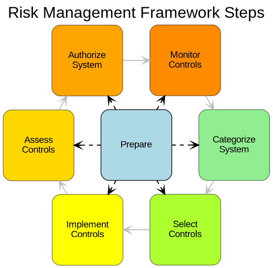

# ss-flowchart

[](https://github.com/enonymous1/ss-flowchart/actions/workflows/ci.yml)
[](LICENSE)
[](pyproject.toml)

Your pipeline lives in YAML. This turns it into a diagram you can actually share.

ss-flowchart reads a structured build or process definition in YAML or JSON,
builds a dependency graph from its steps, and renders a clean flowchart with
Graphviz, no manual drawing, no dragging boxes around.



## Why use it

- Visualize build pipelines, deployment workflows, approval processes, and
  other directed workflows in seconds.
- Keep process definitions in code-friendly YAML/JSON, versioned right
  alongside your project.
- Regenerate the diagram when the process changes, instead of redrawing it.
- Get DOT source without any Graphviz binary installed, for CI checks and
  previews.

## Non-goals

- Not a diagram editor. There is no GUI and no drag-and-drop.
- Not a pipeline runner. It draws the process; it does not execute it.
- Not a Mermaid/Pyvis replacement. Graphviz is the only shipped renderer,
  though the renderer interface is abstract so another backend can be added.

## Prerequisites

You need Python 3.10 or newer.

For PNG, SVG, or PDF output you also need the Graphviz system binary
(`dot`). DOT output works without it.

```bash
# Debian/Ubuntu
sudo apt-get update && sudo apt-get install -y graphviz

# macOS
brew install graphviz

# Windows (PowerShell)
winget install Graphviz.Graphviz
```

## Quick start

```bash
python -m pip install -U pip
python -m pip install -e .

ss-flowchart --input examples/ss-flowchart-process/build.yaml --output flowchart --format dot
```

Real output:

```
Diagram created at: flowchart.dot
```

Then, with the Graphviz binary installed, the same input renders an image:

```bash
ss-flowchart --input examples/ss-flowchart-process/build.yaml --output flowchart --format png
```

Or regenerate an example in place, using the metadata in its YAML file:

```bash
ss-flowchart --input examples/rmf_flowchart/build.yaml --format png
```

## Usage

```
ss-flowchart --input <definition.yaml|json> [--output <path-prefix>]
             [--output-dir <dir>] [--title <title>]
             [--format png|svg|pdf|dot] [--engine dot|neato|...]
             [--strict-acyclic] [--version]
```

Output resolution, in order:

1. `--output` is used as-is. It is a full path prefix, so `--output-dir`
   is ignored when `--output` is given.
2. Otherwise the file's `output` metadata is used, joined with
   `--output-dir`, the file's `output_dir`, or the current directory.
3. Otherwise `build_diagram` is used.

A trailing `.png`, `.svg`, `.pdf`, or `.dot` on the output prefix is
stripped, so `--output diagram.png --format dot` produces `diagram.dot`,
not `diagram.png.dot`. Parent directories are created as needed.

Errors are one line on stderr with exit code 2, not a traceback:

```
$ ss-flowchart --input does-not-exist.yaml --format dot
ss-flowchart: error: [Errno 2] No such file or directory: 'does-not-exist.yaml'
```

### Cycles

Cycles are allowed by default. Process diagrams loop back on purpose: in
the RMF example, Monitor feeds back into Categorize. If your graph must be
a DAG, pass `--strict-acyclic` and a cycle becomes an error instead.

### Example input

```yaml
title: Risk Management Framework Steps
engine: neato
output: examples/rmf_flowchart/rmf_flowchart
steps:
  - id: Prepare
    label: Prepare
    fillcolor: "#ADD8E6"
    color: "black"
  - id: Categorize
    label: "Categorize\nSystem"
    depends_on: [Prepare, Monitor]
    fillcolor: "#90EE90"
```

Each step takes `id` (or `name`), an optional `label` (defaults to the
id), `depends_on` (a string, or a list; `dependencies` is accepted too),
and any extra keys become Graphviz node attributes, like `fillcolor`.

## Design

This project separates the core workflow into three layers:

1. **Parser**: reads structured build input (JSON/YAML) and converts it
   into `BuildStep` objects.
2. **Core graph**: builds an internal dependency graph and validates it
   (duplicates, unknown dependencies, and optionally cycles).
3. **Renderer**: translates the graph into a Graphviz diagram. The
   `BaseRenderer` interface keeps the input/output flow independent of
   the backend, so another renderer can be added later.

<details>
<summary>Project layout</summary>

```
src/build_viz/
  cli.py            # argparse CLI, output resolution, exit codes
  core_graph.py     # step list -> BuildGraph, validation
  models.py         # BuildStep, BuildDefinition, BuildGraph
  parser.py         # YAML/JSON loading and validation
  renderers/
    base.py             # BaseRenderer interface
    graphviz_renderer.py  # Graphviz renderer + DOT source
tests/
  test_cli.py test_core_graph.py test_models.py
  test_parser.py test_renderers.py
examples/
  rmf_flowchart/          # cyclic RMF process, neato engine
  ss-flowchart-process/   # linear flowchart-creation process, dot engine
```

</details>

<details>
<summary>Development</summary>

```bash
python -m pip install -e ".[dev]"
ruff check .
ruff format --check .
mypy src
pytest -q
```

The full suite runs without the Graphviz binary. The one PNG render test
is marked `integration` and skipped when `dot` is not on PATH:

```bash
pytest -q -m "not integration"   # no binary needed
pytest -q                        # with graphviz installed, runs everything
```

</details>

## License

MIT. See [LICENSE](LICENSE).
